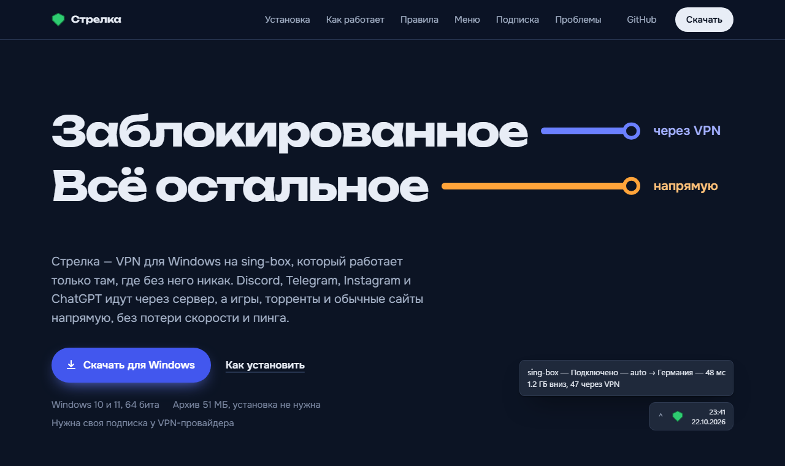
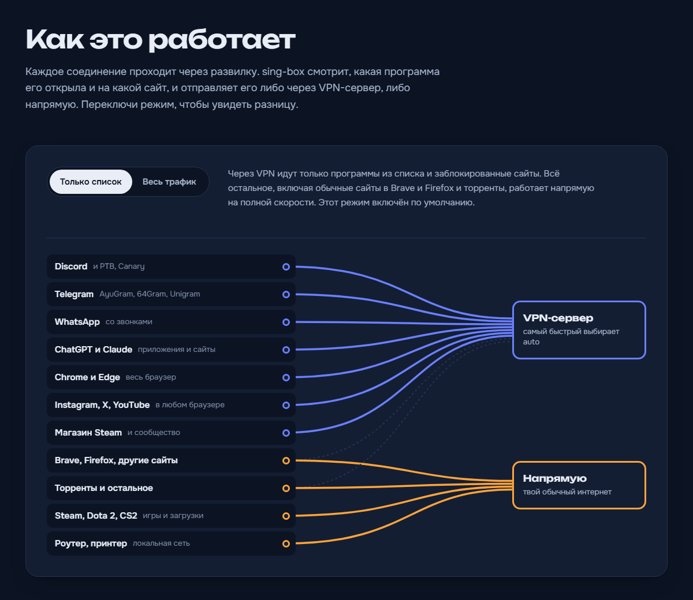

# Стрелка

**VPN для Windows на sing-box, который включается только там, где без него никак.**
Discord, Telegram, WhatsApp, ChatGPT и заблокированные сайты идут через VPN-сервер,
а игры, торренты и обычные сайты работают напрямую, без потери скорости и пинга.



**[Скачать для Windows](https://github.com/MadBl1ss/strelka-sing-box/releases/latest/download/strelka-sing-box-windows-x64.zip)**:
Windows 10 и 11, 64 бита. Нужна своя подписка у VPN-провайдера.

**[Инструкция с картинками: strelka-site.vercel.app](https://strelka-site.vercel.app)**.
На сайте можно проверить, пойдёт ли нужная программа или сайт через VPN. Некоторые
провайдеры в России блокируют адреса Vercel, и тогда сайт открывается только через
VPN. Всё нужное для установки есть и в этом README.

## Что умеет

- **Раздельное туннелирование (split tunneling)** по программам и по сайтам. Через VPN
  идут только списки, всё остальное напрямую.
- **Автосписок заблокированного.** Около 1200 сайтов из
  [itdoginfo/allow-domains](https://github.com/itdoginfo/allow-domains) (это те же
  списки, что ставят на роутеры) плюс ИИ от Google. Работает в любом браузере и
  обновляется сам раз в сутки.
- **Два режима**, переключаются в меню мгновенно: «только список» или «весь трафик».
- **Подписки** VLESS (в том числе REALITY и XHTTP), Trojan, Shadowsocks и Hysteria2,
  несколько провайдеров сразу. Группа auto сама выбирает самый быстрый сервер.
- **Иконка-щит в трее**: цвет показывает состояние, из меню выбирается сервер и
  запускается тест скорости.
- **Страница правил**: добавить программу или сайт и посмотреть, что куда соединяется
  прямо сейчас. Правки работают без перезапуска.
- **Раздельный DNS**: заблокированные сайты резолвятся через DoH внутри VPN, и
  провайдер не подсунет заглушку.

## Установка

1. Скачай архив. **До распаковки** нажми по нему правой кнопкой, открой «Свойства»,
   поставь галку «Разблокировать» и нажми ОК. Распакуй куда угодно, кроме Program
   Files, например в `C:\VPN\`.
2. Открой `subscription.txt` Блокнотом, вставь ссылку на подписку и сохрани.
3. Запусти `sing-box-tray.exe` и согласись на права администратора.

Через полминуты щит у часов станет зелёным. Дальше VPN поднимается сам при входе в
Windows. Подробности и решение проблем есть в `README.txt` внутри архива и
[на сайте](https://strelka-site.vercel.app/#help).

## Что идёт через VPN

| Через VPN | Напрямую |
| --- | --- |
| Discord, Telegram (и AyuGram, 64Gram, Unigram), WhatsApp со звонками, Signal, Viber | Steam, Dota 2, CS2 и загрузки игр |
| ChatGPT, Claude, VS Code, Cursor, Spotify, Notion, Roblox | Роутер, принтер, локальная сеть |
| Google Chrome и Microsoft Edge целиком | Brave, Firefox и другие браузеры, кроме заблокированных сайтов |
| Магазин и сообщество Steam | Торренты, банки, Госуслуги и всё, чего нет в списках |
| Автосписок: Instagram, X, YouTube, LinkedIn, Gemini и ещё ~1200 сайтов | |

Точные списки лежат в [`package/rules`](package/rules): `vpn.json` и `direct.json`.
Проверить конкретную программу или сайт можно [на сайте](https://strelka-site.vercel.app/#rules).
Свои правки делаются из меню щита, пункт «Правила маршрутизации…».

## Как устроено

Стрелка состоит из иконки в трее (`tray/`, Go) и готового конфига для
[sing-box](https://github.com/SagerNet/sing-box).



- sing-box создаёт виртуальный сетевой адаптер (TUN) и решает для каждого соединения,
  куда его отправить. Сначала проверяется `rules/direct.json`, потом `rules/vpn.json`,
  потом автосписок. Всё остальное уходит напрямую.
- Автосписки подключены как удалённые rule-set'ы с `initial_path`: стартовая копия
  лежит в `rules/*.srs`, поэтому VPN запускается, даже если GitHub недоступен.
- Серверы, которые sing-box не умеет (часть VLESS REALITY и все XHTTP), обслуживает
  [Xray](https://github.com/XTLS/Xray-core) на локальных портах.
- Трей скачивает подписку (с заголовком `x-hwid` для панелей с лимитом устройств),
  собирает из неё outbounds, следит за состоянием через Clash API и регистрирует
  автозапуск в планировщике задач.

## Сборка из исходников

Нужны Go 1.27+ и PowerShell 7. Бинарники третьих сторон в репозиторий не входят:
скачай их с официальных страниц и сложи в одну папку.

- `sing-box.exe`, `libcronet.dll`, `LICENSE` из
  [sing-box 1.14 windows-amd64](https://github.com/SagerNet/sing-box/releases)
- `xray.exe`, а также `LICENSE` под именем `xray-LICENSE.txt` из
  [Xray-windows-64](https://github.com/XTLS/Xray-core/releases)
- папка `ui\` из [MetaCubeXD gh-pages](https://github.com/MetaCubeX/metacubexd/archive/refs/heads/gh-pages.zip)

```powershell
node scripts/update-lists.mjs                      # свежие автосписки
.\scripts\build-release.ps1 -Bin C:\path\to\bin    # dist\strelka-sing-box-windows-x64.zip
cd tray; go test ./...                             # тесты трея
```

Скрипт сборки проверяет конфиг через `sing-box check` и отказывается собирать архив,
если в него попали личные файлы (`hwid.txt`, `xray.json`, ссылка в `subscription.txt`).

## Структура

```
tray/      иконка в трее и логика: подписки, правила, режимы, автозапуск
package/   шаблоны, которые уходят в архив: config.json, rules, README.txt
scripts/   сборка релиза и обновление автосписков
```

## Лицензии

Код этого репозитория распространяется под лицензией [MIT](LICENSE). В архив с
релизом также входят:

- [sing-box](https://github.com/SagerNet/sing-box), GPL-3.0-or-later. Стрелка не
  связана с проектом sing-box и не одобрена им.
- [Xray-core](https://github.com/XTLS/Xray-core), MPL-2.0
- [MetaCubeXD](https://github.com/MetaCubeX/metacubexd), MIT
- списки [itdoginfo/allow-domains](https://github.com/itdoginfo/allow-domains)

---

### English

**Strelka** is a split-tunneling VPN client for Windows built on sing-box. Only the
listed apps (Discord, Telegram, WhatsApp, ChatGPT, Chrome, Edge…) and sites blocked
in Russia go through the VPN, and everything else stays direct. It supports VLESS
(REALITY, XHTTP via Xray), Trojan, Shadowsocks and Hysteria2 subscriptions, has a
tray icon with server selection and two modes (rule / global), and auto-updates the
blocked-domain list from itdoginfo/allow-domains.
